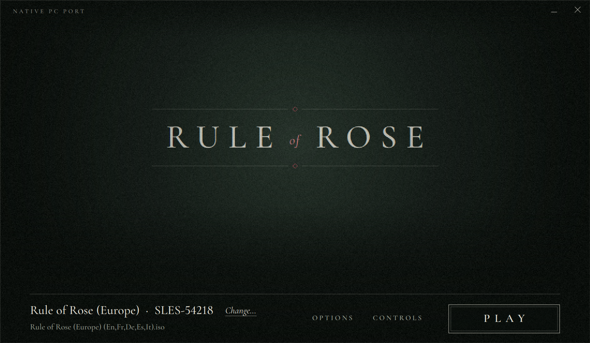

<p align="center">
  
</p>

<p align="center">
  <b>Rule of Rose (PlayStation 2) running natively on Windows and Linux,<br>built on your PC from your own copy of the game.</b>
</p>

<p align="center">
  <a href="#project-status">Status</a> ·
  <a href="#features">Features</a> ·
  <a href="#playing">Playing</a> ·
  <a href="#how-to-build">How to build</a> ·
  <a href="#how-it-works">How it works</a> ·
  <a href="#want-to-help">Want to help?</a> ·
  <a href="#credits">Credits</a> ·
  <a href="#license">License</a>
</p>

<p align="center">
  
  
</p>

This is a static recompilation of the European release of *Rule of Rose*
(SLES-54218). The game's MIPS machine code is translated ahead of time into C,
compiled for x86-64 and linked against a runtime that stands in for the PS2:
kernel, graphics, sound, movies, disc, memory card and pad. It is not an
emulator, and there is no interpreter or JIT in the game you end up running.

> [!IMPORTANT]
> This repository **does not contain the game, its executable or any of its
> assets**, and it does not explain how to get them. You need your own copy of
> the disc as an `.iso` image. Everything the build makes from it stays on
> your PC. Do not share those files.

## Project status

**Early, but it boots and plays.** The game runs from power-on into the first
gameplay area with sound and movies. Nothing beyond that has been played yet.

| | Status |
|---|---|
| Boot, intro movies, title screen, New Game opening | Works |
| First gameplay area | Works |
| Later areas, combat, saving at a save point | Not tested yet |
| Sound | Works, no reverb |
| Windows 10/11 x64, Linux x86-64 | Works |
| Software renderer | Works, pixel-exact, full speed |
| GPU renderer (Vulkan) | Works, tested on one GPU (RTX 3090) |
| Widescreen | Experimental |
| Xbox and PlayStation pads | Written, not yet tried on real hardware |

The full list of what is missing or unverified is in
[docs/STATUS.md](docs/STATUS.md).

## Features

- **Two renderers.** A software renderer that matches the PS2 pixel for pixel,
  and a Vulkan renderer that draws at up to 8x the original resolution.
- **High refresh rates.** The game draws 25 pictures a second. The GPU
  renderer builds the in-between pictures from the game's own geometry, up to
  the refresh rate of your display (240 Hz measured).
- **Widescreen.** 16:9, 21:9 and 32:9 with a wider 3D view. Text and menus keep
  their proportions.
- **Upscaling.** AMD FSR 1.0 on both renderers, FSR 3.1 on Windows with the
  GPU renderer.
- **Picture controls.** Brightness, contrast, gamma, saturation, bloom and the
  strength of the game's film grain.
- **Input.** Keyboard, Xbox pads, DualShock 4 and DualSense, with analog
  movement and vibration.
- **A launcher** that finds your disc image and holds all of the above.

## Playing

Build the packages as described below, then start the launcher:

| Platform | Start |
|---|---|
| Windows | `dist/RuleOfRose-windows/RuleOfRose.exe` |
| Linux | `dist/RuleOfRose-linux/RuleOfRose` |

Point it at your disc image, pick your options and press **PLAY**. Saves go to
`saves/mc0/` next to the launcher; that folder is the memory card.

- Keyboard and gamepad mapping: [docs/CONTROLS.md](docs/CONTROLS.md)
- Running the game without the launcher: [docs/OPTIONS.md](docs/OPTIONS.md)

## How to build

Builds run on Linux (WSL2 is fine) with a user-space toolchain, no root
needed. The Windows build is cross-compiled from the same machine.

| You need | Where |
|---|---|
| clang 18 | `~/.local/opt/clang` |
| glibc and X11 headers | `tools/debs/`, fetched by `tools/fetch-debs.sh` |
| [llvm-mingw](https://github.com/mstorsjo/llvm-mingw) (clang 18, UCRT) | `tools/llvm-mingw/` |
| Qt 6.8, Linux and `win64_llvm_mingw` kits | `~/.local/opt/qt6/` |
| Vulkan headers and glslang | `tools/vulkan/` |
| Python 3, CMake, Ninja | on your `PATH` |
| AMD FidelityFX SDK 2.4.0 (optional, for FSR 3.1) | `tools/ffx/` |

Put your disc image in the repository root as
`Rule of Rose (Europe) (En,Fr,De,Es,It).iso`, or set `ROR_ISO=/path/to.iso`.
Then:

```sh
recomp/build.sh          # game, Linux     -> build/recomp/ror
recomp/build-win.sh      # game, Windows   -> build/recomp/win/ror.exe
tools/build.sh           # launcher, Linux
tools/build-win.sh       # launcher, Windows
recomp/package.sh all    # dist/RuleOfRose-linux, dist/RuleOfRose-windows
```

The game build takes the executable out of your image, recompiles it and
links it with the runtime. Everything it produces lands under `build/`, which
git ignores.

## How it works

| Part | Where | What it does |
|---|---|---|
| Recompiler | `recomp/*.py` | Decodes the game's R5900 code and writes one C function per game function. The same templates generate a reference interpreter used for checking. |
| Runtime | `recomp/rt/` | The PS2 as the game sees it: kernel calls and threads, memory, DMA, both vector units, the Graphics Synthesizer, the MPEG-2 decoder and the I/O services (disc, pad, memory card, the game's sound driver). |
| Renderers | `recomp/rt/gs.c`, `recomp/rt/hw/` | Software, and Vulkan with frame interpolation, widescreen and upscaling. |
| Platform layer | `recomp/rt/plat*`, `video_*`, `audio_*`, `pad_*` | X11, PulseAudio and evdev on Linux; Win32, waveOut, XInput and HID on Windows. |
| Launcher | `launcher/` | Qt 6 front end. |
| Tools | `recomp/tools/` | Disassemblers, capture and replay tools, comparison scripts. |

Run headless, the game is deterministic. Every change is checked by a scripted
run from boot into gameplay that must produce the same frames and the same
audio, byte for byte, on Linux and on Windows. The recipe and the notes on the
game's internals are in [recomp/NOTES.md](recomp/NOTES.md).

## Want to help?

- Play past the first area and report what breaks.
- Try a real controller on Windows or Linux.
- Try the GPU renderer on AMD or Intel graphics, or on Linux with a real
  Vulkan driver.
- Compare the sound with a real console.

Issues and pull requests are welcome. Please do not attach or link anything
from the game itself.

## Credits

- [AMD FidelityFX Super Resolution](https://github.com/GPUOpen-LibrariesAndSDKs/FidelityFX-SDK):
  FSR 1.0 (MIT) is ported in `recomp/rt/post.c`; FSR 3.1 is loaded from AMD's
  own signed libraries when they are present.
- [Cormorant Garamond](https://github.com/CatharsisFonts/Cormorant) (SIL Open
  Font License), the launcher's typeface.
- [Qt](https://www.qt.io/) 6 (LGPL v3).
- The PS2 homebrew and emulation communities, for documenting the hardware.

*Rule of Rose* belongs to its respective owners. This project is not
affiliated with or endorsed by them.

## License

[MIT](LICENSE). Third-party pieces keep their own licences, as listed above.
