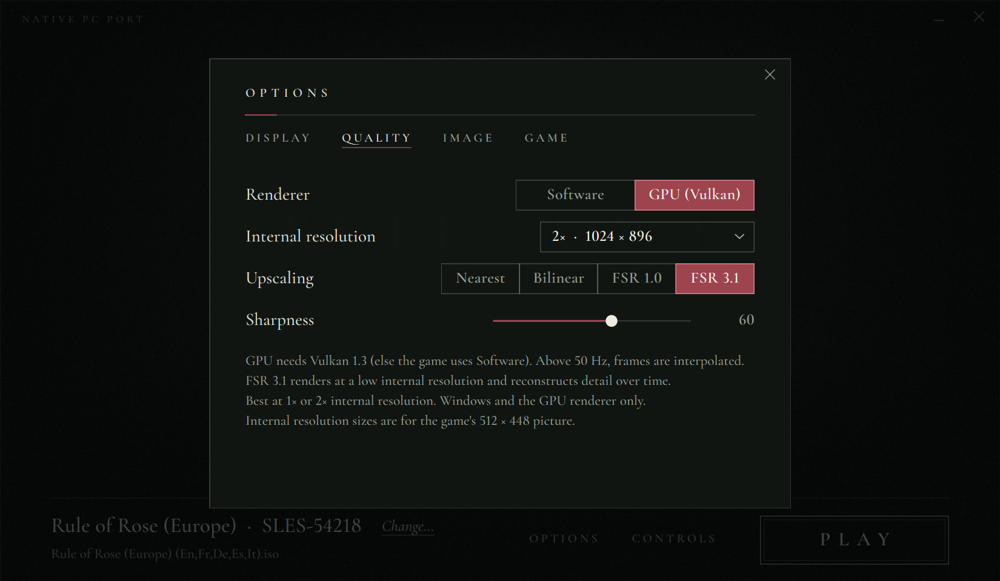

<p align="center">
  
</p>

<p align="center">
  <b>Rule of Rose (PlayStation 2) as a native Windows and Linux game,<br>made on your PC from your own copy.</b>
</p>

<p align="center">
  <a href="#download-and-play">Download and play</a> ·
  <a href="#features">Features</a> ·
  <a href="#whats-next">What's next</a> ·
  <a href="#how-to-build">How to build</a> ·
  <a href="#how-it-works">How it works</a> ·
  <a href="#credits">Credits</a> ·
  <a href="#license">License</a>
</p>

<p align="center">
  
  
</p>

A PC version of *Rule of Rose*. It works with the European disc (SLES-54218)
and the North American disc (SLUS-21448). You download
the launcher from this page, point it at your own copy of the game, and it
does the rest: it prepares the game for your PC once, then you press PLAY.
No emulator to set up and nothing else to install.

> [!IMPORTANT]
> **The game itself is not included, here or in the downloads.** You need your
> own copy of the disc as an `.iso` image, and this project does not explain
> how to get one. What the launcher makes from your disc stays on your PC.
> Please do not share those files.

## Download and play

1. **Download** the latest package from the
   [Releases page](https://github.com/ptfpinho23/rule-of-rose-recomp/releases/latest):
   the `.zip` for Windows 10/11, or the `.tar.gz` for Linux.
2. **Unpack** it anywhere and start `RuleOfRose.exe` (Windows) or
   `./RuleOfRose` (Linux).
3. **Choose your disc image.** The launcher checks that it is the right game
   and tells you which disc it is, European or USA.
4. **Press PREPARE GAME.** This happens once per disc and takes a few minutes.
   You only see it again after updating to a new release.
5. **Press PLAY.**

That is all. You do not need to install anything else or build anything
yourself.

Your saves are kept in the `saves` folder next to the launcher; each disc has
its own memory card there, so the two never mix. The keyboard
and gamepad layout is on the launcher's Controls screen and in
[docs/CONTROLS.md](docs/CONTROLS.md).

## Features

- **Sharper picture.** Play at the original PS2 resolution or at up to 8 times
  that on your graphics card.
- **Smooth motion.** The original shows 25 pictures a second (30 on the USA
  disc). The PC version
  can fill in the frames in between, up to your monitor's refresh rate.
- **Widescreen.** 16:9, 21:9 and 32:9, showing more of the scene to the sides
  instead of stretching it.
- **Upscaling.** AMD FSR 1.0, and on Windows FSR 3.1 and NVIDIA DLSS (you add
  NVIDIA's files yourself, see [docs/OPTIONS.md](docs/OPTIONS.md)).
- **Picture settings.** Brightness, contrast, gamma, saturation, bloom, and
  how strong the game's film grain is.
- **Controllers.** Keyboard, Xbox pads, DualShock 4 and DualSense.
- **One launcher** for all of it, in window or fullscreen.

## What's next

- **Playing further.** Only the opening and the first area have been played;
  later areas, combat and saving at a save point come next.
- **Frame generation.** FSR and DLSS frame generation on top of the upscalers.
- **More graphics cards.** The high-resolution renderer has been tried on one
  card so far (RTX 3090); AMD and Intel cards and Linux Vulkan drivers are
  still to be checked.
- **Controllers.** A DualSense has been played with; Xbox pads and the
  DualShock 4 still need trying on real hardware.
- **Sound.** Reverb, and a comparison with a real console.
- **Widescreen** beyond the first area.

What is missing or unverified today is listed in
[docs/STATUS.md](docs/STATUS.md). Issues and pull requests are welcome; please
do not attach or link anything from the game itself.

## How to build

This section and the next are for people who want to work on the project.
Players do not need any of it.

The project is a static recompilation. The game's MIPS R5900 machine code is
translated ahead of time into C, compiled for x86-64 and linked against a
runtime that stands in for the PS2. There is no interpreter or JIT in the
result. Because that translation is made from the game's executable, it is
never committed or published: the build makes it from your disc image, and
the released launcher does the same on the player's machine (that is what
PREPARE GAME runs).

Builds run on Linux with a user-space toolchain, no root needed. The Windows build is cross-compiled from the same machine.

| You need | Where |
|---|---|
| clang 18 | `~/.local/opt/clang` |
| glibc and X11 headers | `tools/debs/`, fetched by `tools/fetch-debs.sh` |
| [llvm-mingw](https://github.com/mstorsjo/llvm-mingw) (clang 18, UCRT) | `tools/llvm-mingw/` |
| Qt 6.8, Linux and `win64_llvm_mingw` kits | `~/.local/opt/qt6/` |
| Vulkan headers and glslang | `tools/vulkan/` |
| Python 3, CMake, Ninja | on your `PATH` |
| AMD FidelityFX SDK 2.4.0 (optional, for FSR 3.1) | `tools/ffx/` |

Put your disc image in the repository root as
`Rule of Rose (Europe) (En,Fr,De,Es,It).iso`, or set `ROR_ISO=/path/to.iso`.
For the USA disc the name is `Rule of Rose (USA).iso`, and the two game build
scripts take `GAME=ntsc` (outputs under `build/recomp/ntsc/`, beside the
European ones). Then:

```sh
recomp/build.sh          # game, Linux     -> build/recomp/ror
recomp/build-win.sh      # game, Windows   -> build/recomp/win/ror.exe
tools/build.sh           # launcher, Linux
tools/build-win.sh       # launcher, Windows
recomp/package.sh all    # dist/RuleOfRose-linux, dist/RuleOfRose-windows
```

Everything made from the game lands under `build/` and `dist/`, which git
ignores. The switches of the game executable are in
[docs/OPTIONS.md](docs/OPTIONS.md).

Releases are built by GitHub Actions when a `v*` tag is pushed. They contain
the launcher, the runtime, the recompiler and a bundled compiler, and no game
code.

## How it works

| Part | Where | What it does |
|---|---|---|
| Recompiler | `recomp/*.py` | Decodes the game's R5900 code and writes one C function per game function. The same templates generate a reference interpreter used for checking. |
| Runtime | `recomp/rt/` | The PS2 as the game sees it: kernel calls and threads, memory, DMA, both vector units, the Graphics Synthesizer, the MPEG-2 decoder and the I/O services (disc, pad, memory card, the game's sound driver). |
| Renderers | `recomp/rt/gs.c`, `recomp/rt/hw/` | Software, and Vulkan with frame interpolation, widescreen and upscaling. |
| Platform layer | `recomp/rt/plat*`, `video_*`, `audio_*`, `pad_*` | X11, PulseAudio and evdev on Linux; Win32, waveOut, XInput and HID on Windows. |
| Launcher | `launcher/` | Qt 6 front end. |
| Tools | `recomp/tools/` | Disassemblers, capture and replay tools, comparison scripts. |

What differs between the two discs (the name and hash of the executable, three
addresses, 50 or 59.94 Hz) is one small table, `recomp/games.py`.

Run headless, the game is deterministic. Every change is checked by a scripted
run from boot into gameplay that must produce the same frames and the same
audio, byte for byte, on Linux and on Windows. The recipe and the notes on the
game's internals are in [recomp/NOTES.md](recomp/NOTES.md).

## Credits

- [AMD FidelityFX Super Resolution](https://github.com/GPUOpen-LibrariesAndSDKs/FidelityFX-SDK):
  FSR 1.0 (MIT) is ported in `recomp/rt/post.c`; FSR 3.1 is loaded from AMD's
  own signed libraries when they are present.
- [Cormorant Garamond](https://github.com/CatharsisFonts/Cormorant) (SIL Open
  Font License), the launcher's typeface.
- [Qt](https://www.qt.io/) 6 (LGPL v3).
- The PS2 homebrew and emulation communities, for documenting the hardware.

*Rule of Rose* belongs to its respective owners. This project is not
affiliated with or endorsed by them.

## License

[MIT](LICENSE). Third-party pieces keep their own licences, as listed above.
